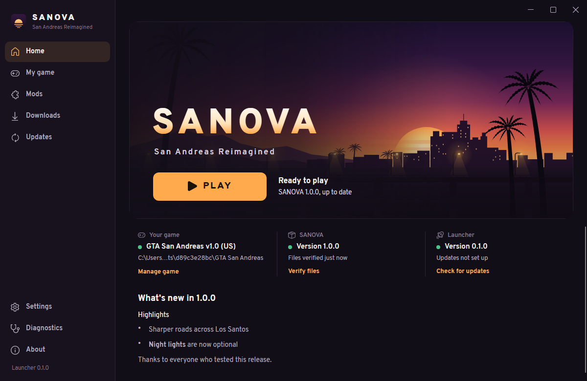
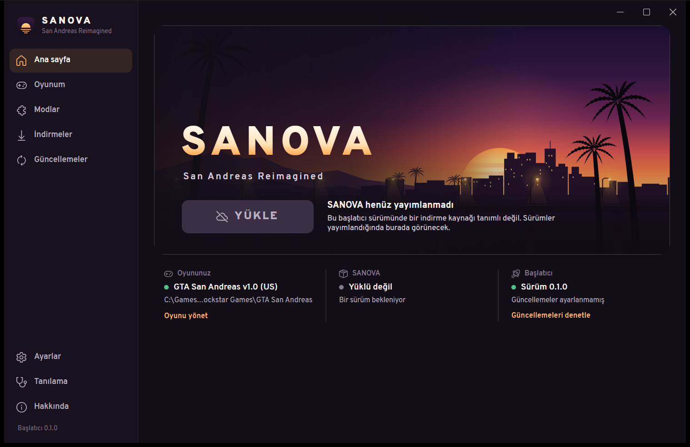
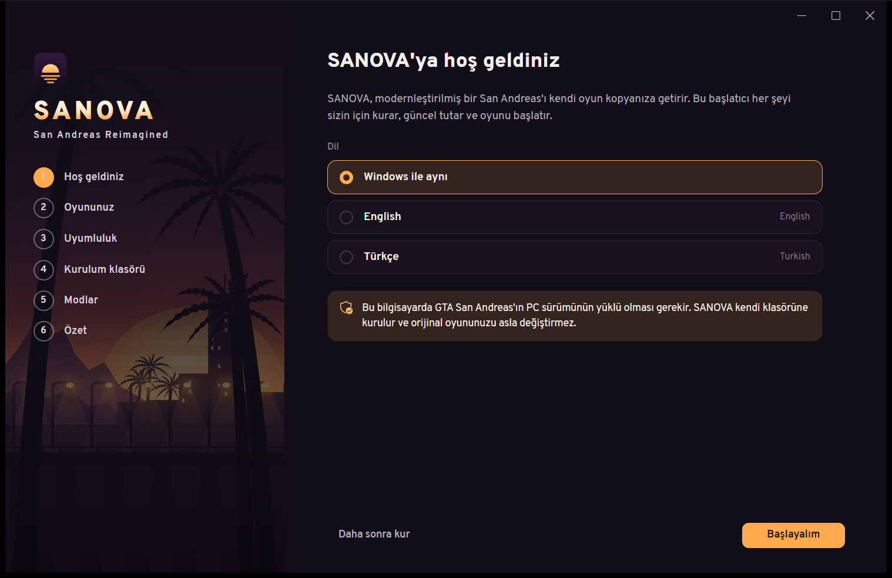
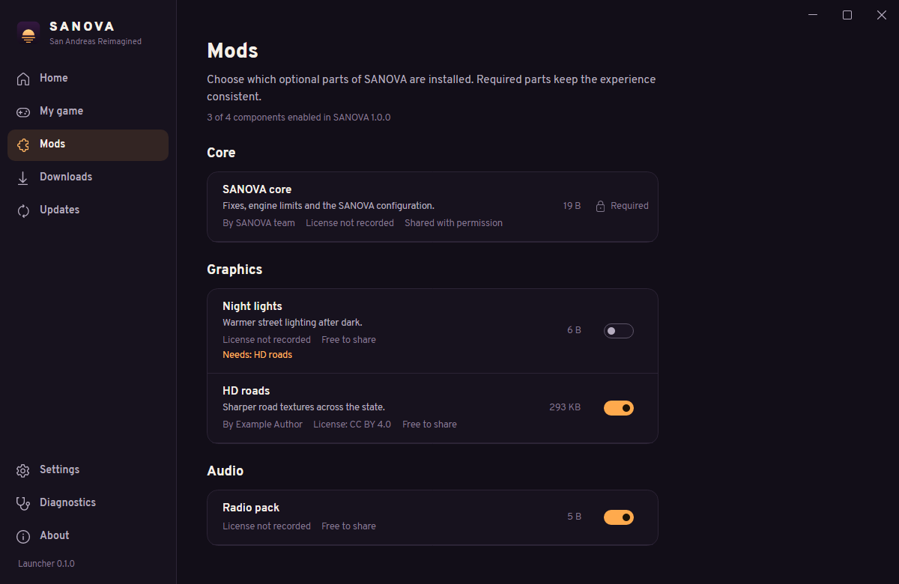

# SANOVA Launcher

[](https://github.com/yusuf-toktas/SANOVA-Launcher/actions/workflows/ci.yml)
[](LICENSE)

The installer, updater and launcher for **SANOVA — San Andreas Reimagined**, a community project
that modernizes the 2005 PC release of *Grand Theft Auto: San Andreas* while keeping its
character.

Point the launcher at your own copy of the game and it does the rest: it checks the game
version, builds a separate SANOVA installation (your original game is never modified), installs
and verifies the SANOVA content, keeps it updated, and starts the game.

> SANOVA is an independent community project. It is not affiliated with, endorsed by or
> sponsored by Rockstar Games or Take-Two Interactive. You need your own legally obtained copy of
> the game; the launcher does not distribute it.



*The home screen with a locally built test release.*

## Status

The first version of the launcher is implemented and tested, but **no launcher or SANOVA content
release has been published yet**. Until release sources are configured in
[`src/Sanova.Launcher/distribution.json`](src/Sanova.Launcher/distribution.json), the launcher
says so instead of pretending a release exists:



[Releasing](docs/RELEASING.md) and the [content pipeline](docs/CONTENT-PIPELINE.md) describe
what the SANOVA team configures before the first release.

## Features

**Game**
- Finds GTA San Andreas through the retail installer's registry keys, installed-programs
  entries, Steam libraries, the SA-MP client setting and common folders, or lets you choose
  the folder.
- Identifies the executable by hash (the original v1.0 US retail executable is verified),
  recognizes the Steam/Rockstar Games Launcher re-release, the Definitive Edition and modified
  executables, and explains incompatibilities in plain language.
- Checks the installation against a reference list of the 416 original v1.0 files, reporting
  missing files, changed files and leftover mods before anything is installed.
- Installs SANOVA into **its own folder**, copied from your original game. Folder names the
  2005 game can't open (characters outside the Windows ANSI code page) are rejected up front.
- Launches the game, detects when it's running, and backs up saved games automatically, with
  one-click restore.

**Installation engine**
- Transactional changes: every change is journaled and original files are backed up. Failures,
  cancellation or a power loss roll back to the previous state on the next start.
- Files placed by SANOVA are tracked with SHA-256. Files you added are never deleted or
  overwritten; anything in the way is moved to a backup and reported.
- Verify and repair: re-downloads damaged content and re-copies damaged original files.
- Optional components with dependencies and conflicts. Disabled components are parked, so
  enabling them again needs no download.
- Safe uninstall: removes only what SANOVA placed and keeps files you changed or added.

**Downloads and updates**
- Content releases are described by a manifest, signed with ECDSA P-256, and published on GitHub
  Releases, any HTTPS host, or a local folder for testing. The launcher can require a valid
  signature before downloading anything.
- Resumable, verified downloads with mirrors, retries, a speed limit and parallel transfers.
- Differential updates fetch only changed files. When a small part of a large package is needed,
  the launcher reads just those files through HTTP range requests.
- Mods that may not be redistributed can be downloaded from their authors' own pages and are
  verified by hash.
- The launcher updates itself through Velopack (full or delta packages, applied after the
  launcher exits, no administrator rights).

**Everything else**
- English and Turkish, switchable instantly.
- Dark (default) and light themes with an original visual identity; icon buttons carry
  accessible names for screen readers.
- Diagnostics page with checks, the recent log, and a shareable report with your user name,
  computer name and profile paths removed.

| First-run setup (Turkish) | Mods page (test content) |
|---|---|
|  |  |

## Installation

There is no downloadable release yet. Once one is published, it will be on the
[Releases page](https://github.com/yusuf-toktas/SANOVA-Launcher/releases): download
`SANOVA.Launcher-win-Setup.exe` and run it. The launcher installs for the current Windows user
and doesn't need administrator rights.

You'll need:

- Windows 10 or 11 (64-bit).
- A legally obtained PC copy of *Grand Theft Auto: San Andreas*. The original v1.0 (US)
  executable is the version supported today; the launcher explains what to do with other
  versions.
- Free disk space for the SANOVA copy of the game (about 5 GB) plus the SANOVA content.

## Using the launcher

1. **First start.** Choose a language. The launcher finds your game (or you choose the folder),
   checks its version and files, suggests a folder for the SANOVA installation, and lets you pick
   optional mods.
2. **Home.** One main button follows the state of your installation: **Install**, **Update** or
   **Play**.
3. **My game.** Change the game folder, verify or repair the installation, uninstall SANOVA,
   and back up or restore saved games.
4. **Mods.** Turn optional components on or off; required components stay on.
5. **Updates.** See and apply content and launcher updates, with release notes.
6. **Diagnostics.** Run checks, read the recent log, and export a report to share when asking
   for help.
7. **Settings.** Language, theme, folders, download speed and parallel downloads, update
   channel, save backups and advanced options.

The launcher keeps its settings, logs, caches and save backups in `%LocalAppData%\SANOVA`.
Saved games stay where the game keeps them (`Documents\GTA San Andreas User Files`).

## Localization

The launcher ships in English and Turkish. It follows the Windows display language on first
start, and you can switch under **Settings → Language** at any time; text changes immediately.
English is the fallback for anything not yet translated.

A new language is a single JSON file. [Localization](docs/LOCALIZATION.md) explains the format,
plural rules, and how translators can try a file in an installed launcher without building it.

## Building from source

Requirements: Windows 10/11 and the [.NET 10 SDK](https://dotnet.microsoft.com/download).

```powershell
dotnet build SANOVA.Launcher.slnx
dotnet run --project src/Sanova.Launcher                 # run the launcher
dotnet test SANOVA.Launcher.slnx                          # run all tests
dotnet run --project src/Sanova.ManifestTool -- --help    # maintainer tool for content releases
./build/package.ps1 -Version 0.1.0                        # Velopack installer into artifacts/releases
```

Delete `%LocalAppData%\SANOVA` to see the first-run setup again. To try the full install flow
before anything is published, build a test release with the manifest tool (see the
[content pipeline](docs/CONTENT-PIPELINE.md)), then enable **Settings → Advanced → Developer
mode** and set the content source to that local folder.

### Repository layout

| Path | Contents |
|---|---|
| `src/Sanova.Core` | UI-independent engine: detection, compatibility, manifests, downloads, transactional installation, updates, diagnostics, localization |
| `src/Sanova.Launcher` | Avalonia desktop app: views, view models, theme, language files, Velopack integration |
| `src/Sanova.ManifestTool` | `sanova-manifest`: builds, signs and verifies content releases |
| `tests/` | Engine tests and headless UI tests |
| `docs/` | Architecture, content pipeline, releasing, localization and testing guides |
| `build/` | Packaging and icon scripts |
| `.github/` | CI and draft-release workflows, issue templates |

## Documentation

- [Architecture](docs/ARCHITECTURE.md)
- [Content pipeline](docs/CONTENT-PIPELINE.md): turning prepared files into a content release
- [Releasing](docs/RELEASING.md): versioning, launcher builds, GitHub Releases
- [Localization](docs/LOCALIZATION.md): adding and maintaining languages
- [Testing](docs/TESTING.md)
- [Contributing](CONTRIBUTING.md) and [Security](SECURITY.md)
- [Changelog](CHANGELOG.md)

## License

SANOVA Launcher is licensed under the [Apache License 2.0](LICENSE); see also [NOTICE](NOTICE).
Third-party components keep their own licenses, listed in
[THIRD-PARTY-NOTICES.md](THIRD-PARTY-NOTICES.md).

The license covers the launcher's software only. It grants no rights to *Grand Theft Auto: San
Andreas*, which you need to own, or to third-party game modifications, which keep their own
licenses (recorded per component in each SANOVA content release).

## Legal

SANOVA is an independent community project. It is not affiliated with, endorsed by or sponsored
by Rockstar Games or Take-Two Interactive. *Grand Theft Auto* and *Grand Theft Auto: San Andreas*
are trademarks of Take-Two Interactive Software, Inc. The launcher doesn't include or download
any part of the original game and never modifies your original installation; it works with the
copy you own.
