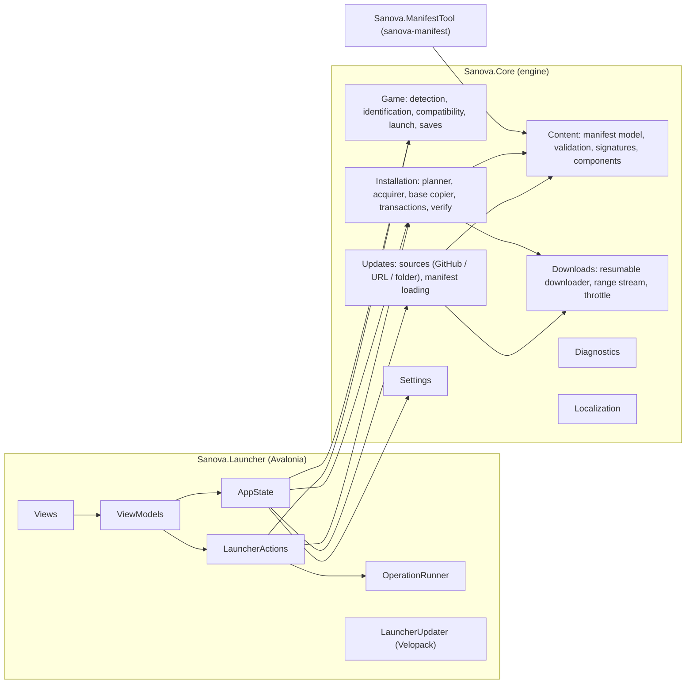

# Architecture

SANOVA Launcher is a .NET 10 desktop application. The UI is built with
[Avalonia UI 12](https://avaloniaui.net/) (MVVM with CommunityToolkit.Mvvm); launcher
self-updates use [Velopack](https://velopack.io/). All installation logic lives in a
UI-independent engine, so it is unit-testable and could serve another front end later.



## Projects

| Project | Role |
|---|---|
| `Sanova.Core` | Engine. No UI dependencies; logs through `Microsoft.Extensions.Logging` abstractions. Produces no user-facing text: failures are `SanovaException`s with stable codes the UI translates. |
| `Sanova.Launcher` | Avalonia application (`SanovaLauncher.exe`). Composition root in `Bootstrapper.cs`. |
| `Sanova.ManifestTool` | Maintainer CLI (`sanova-manifest`) that builds content releases from the `Root/` folder. |
| `Sanova.Core.Tests` | Engine tests, including end-to-end installs into temporary folders. |
| `Sanova.Launcher.Tests` | Headless Avalonia tests: UI state, localization switching, rendered snapshots. |

## Key concepts

### Two installations

The player's **original** GTA San Andreas is read-only input. SANOVA is installed into a
**separate folder**: the original game files are copied there (hashed while copying), then
SANOVA content is applied on top. Saves are shared by every copy of the game (they live in
`Documents\GTA San Andreas User Files`), which is why the launcher backs them up before it
changes anything.

### Managed files

`.sanova/install.json` in the SANOVA folder records every file the launcher placed — its
size, SHA-256, write time, origin (`Base` = copied from the original game, `Content` = from
SANOVA) and owning component. Anything not recorded belongs to the player and is never
deleted or overwritten:

- a player file in a path SANOVA needs is moved to `.sanova/user-backup/<transaction>/` and
  reported;
- a managed file the player edited is backed up before it is replaced, and kept on uninstall;
- an original game file replaced by content is preserved in `.sanova/originals/` and put back
  when that content is removed.

```
<SANOVA folder>/
  gta_sa.exe, models/, data/ ...   original files + SANOVA content
  .sanova/                         (hidden) launcher metadata
    install.json                   installation state — the commit point of every change
    install.next.json              state being committed (only mid-commit)
    journal.json                   active transaction (only mid-transaction)
    manifest/                      the manifest this installation was built from
    staging/<tx>/                  verified files waiting to be moved into place
    tx/<tx>/                       backups taken during a transaction
    originals/                     original files replaced by content
    disabled/                      files of disabled optional components
    user-backup/                   player files moved out of the way
    cache/                         downloaded packages (resumable; cleared after success)
```

### Transactions

Every install, update, repair and component change runs through `TransactionEngine`:

1. **Plan** (`InstallPlanner`) — diff the installation state against the target manifest and
   selection: place, delete, park (`Stash`) or restore (`Unstash`) files. Removals come first.
2. **Acquire** (`ContentAcquirer`) — download and extract the needed files into
   `staging/<tx>/`, verifying size and SHA-256 of every file.
3. **Apply** — write `journal.json`, then execute operations. Each replaced file is moved to
   a backup path unique to that operation.
4. **Commit** — write `install.next.json`, set the journal phase to `Committing`, swap it into
   `install.json` (the commit point), mark `Committed`, then clean up backups according to
   their handling (discard / keep as original / keep as player backup).

On failure or cancellation before the commit point, every operation is undone in reverse.
Undo inspects the file system instead of trusting the journal's progress counter, so it is
correct even when a crash happened between an operation and its journal write. On start-up
the launcher recovers any journal it finds: `Applying` → roll back, `Committing` → finish.
`InstallLock` (an exclusive lock file) and the single-instance mutex prevent two processes
from changing the same installation.

### Content manifests

A release is described by `sanova-manifest.json` (see the
[content pipeline](CONTENT-PIPELINE.md) for the format): components (with dependencies,
conflicts, license and redistribution status), zip packages, and every file with its install
path, size, SHA-256, owning component and package. `ManifestValidator` rejects unsafe paths
(`..`, rooted, device names, alternate data streams, 8.3 aliases, metadata folder),
duplicates, unknown references and dependency cycles before anything else trusts the
manifest. An optional ECDSA P-256 signature (`.sig`) authenticates the exact manifest bytes —
and, through the hashes inside, every package and file — independent of where they are hosted.

Components can also come from the mod author's own site (`External`: downloaded from a direct
link and verified by hash) or be downloaded by the player (`Manual`: the launcher opens the
author's page, then verifies the archive the player picks). This supports mods whose licenses
do not allow redistribution.

### Downloads

`ResumableDownloader` downloads to a `.part` file with resume metadata (ETag/Last-Modified,
`If-Range`), retries transient failures with exponential backoff, falls back to mirrors,
honors the shared speed limit (`BandwidthThrottle`), detects stalls, and only moves the file
into place after its size and SHA-256 match. `file://` sources (local test releases) take the
same path.

For each package `ContentAcquirer` picks the cheapest safe strategy: an existing cache entry,
a local file, a full download, or — when an update needs a small part of a large package —
**remote extraction** through `HttpRangeReadStream`, a seekable stream over HTTP range
requests that `ZipArchive` reads directly. Servers that ignore ranges fall back to a full
download automatically.

### Compatibility

`ExecutableIdentifier` hashes the executable (SHA-256 and MD5, for matching community lists)
and reads its PE header. `GameVersionDatabase` (`Core/Data/game-versions.json`) maps hashes to
versions and support levels; the content manifest can add executables and override support
without a launcher release. Unknown executables are classified heuristically (`gta-sa.exe` =
re-release, a `.securom` section = unrecognized retail build). `CompatibilityChecker` combines
that with the reference file list (`Core/Data/basegame-sa-1.0-us.json`, generated with
`sanova-manifest basegame`) and checks for leftover mods. Errors about the executable version
can be overridden by the player in advanced settings; missing files cannot.

### Updates

Content and launcher updates are independent:

- **Content** — `ContentUpdateService` asks the configured `IContentSource` (GitHub Releases,
  a manifest URL, or a local folder) for the latest release on the selected channel, downloads
  and verifies the manifest, and caches it for offline use. GitHub API responses are cached
  with their ETag, so repeated checks don't count against the anonymous rate limit.
- **Launcher** — `LauncherUpdater` wraps Velopack's `UpdateManager` with a GitHub source (or a
  plain feed URL/folder). Velopack downloads delta or full packages and swaps versions only
  after the launcher exits. Builds that weren't installed by the Velopack installer report
  "development build" instead of attempting an update.

Sources are configured in `src/Sanova.Launcher/distribution.json`; developer mode can override
the content source at runtime.

### Localization

`Localizer` (engine) loads nested JSON language files, flattens keys (`home.status.play.title`),
formats named placeholders with the language's culture, selects CLDR plural forms and falls
back to English. In the UI, `LocalizationService` switches languages at runtime and refreshes
every live `LocalizedString`; XAML uses `{l:Tr key}`. View models expose `LocalizedString`
objects built from producers, so even composed messages re-translate instantly. See
[Localization](LOCALIZATION.md).

### UI composition

- `AppState` — single source of truth (settings, detected games, compatibility, installation,
  latest release, game process state).
- `LauncherActions` — shared workflows (install, update, repair, verify, components,
  uninstall, launch, save backup/restore). Each checks preconditions, backs up saves, runs
  through the `OperationRunner`, and refreshes state.
- `OperationRunner` — runs one operation at a time on a worker thread, samples progress ten
  times a second (speed, time remaining), handles cancellation, explains failures through the
  `DialogService`, and records history.
- `MainViewModel` hosts pages (`ViewLocator` maps view models to views without reflection),
  the first-run `SetupViewModel`, dialogs and toasts.

The visual design ("sodium dusk") is defined in `Themes/Tokens.axaml` (colors per theme,
Fluent overrides) and `Themes/Controls.axaml`. The hero artwork (`Controls/DuskScene.cs`) and
logo (`Controls/LogoMark.cs`) are drawn in code; the application icon is generated by
`build/generate-icon.ps1` from the same geometry.

## Error handling

Expected failures throw `SanovaException` with a code from `ErrorCodes` and arguments. The UI
maps `error.<code>` to a localized message and offers the technical message as details.
Unexpected exceptions are logged with stack traces and shown as a generic error. Logs
(Serilog, `%LocalAppData%\SANOVA\Logs`, 14 days) never contain credentials; the diagnostic
report removes the user profile path, user name and computer name before sharing.

## Security

- No administrator rights (`asInvoker`); installation targets are validated (not system or
  profile folders, not inside the original game, writable, ANSI-compatible, enough space).
- Every path from a manifest or archive is validated and resolved under its root; extraction
  writes to paths from the validated manifest, never from archive entry names, and enforces
  the declared size (zip-bomb guard) and SHA-256.
- Manifests are fetched over HTTPS only (plain HTTP is accepted in developer mode, for local
  test servers); absolute package URLs, mirrors and external mod downloads must be HTTPS.
  Links opened from manifests are limited to http(s).
- Downloads are verified before use; manifests can be signed and signatures required.
- The launcher does not modify or patch game executables and contains no copy-protection
  workarounds.
