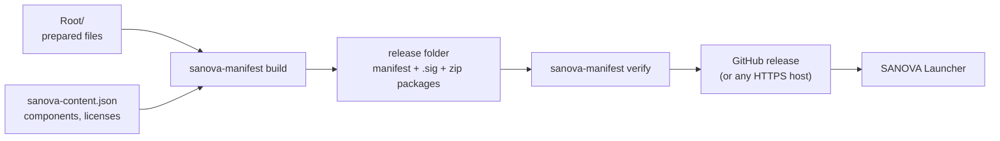

# Content pipeline

How the SANOVA team turns its prepared files into a release that the launcher can install,
update and verify.



The maintainer tool is part of this repository:

```powershell
dotnet run --project src/Sanova.ManifestTool -- <command> [options]
# or a standalone executable: ./build/package.ps1 -IncludeTools  → artifacts/tools/sanova-manifest.exe
```

## 1. The source folder (`Root/`)

`Root/` mirrors the game folder: a file at `Root/modloader/Foo/foo.dff` is installed at
`<SANOVA folder>/modloader/Foo/foo.dff`. It contains only what SANOVA adds or replaces —
never the original game. The launcher copies the original files from the player's own copy
first, then applies the content on top; an original file replaced by content (for example
`data/handling.cfg`) is preserved and restored if that content is removed.

`Root/` and the content configuration live in the SANOVA team's workspace, outside this
repository; the commands below assume they sit next to the launcher checkout. Never commit game
or mod files to the launcher repository.

`build` refuses to package files that are byte-identical to a known original game file (checked
against the embedded v1.0 reference list and the config's `baseGameReference`). This catches
known originals; it cannot establish redistribution rights or identify every proprietary
file, including modified game files. Review the asset list and permissions before publication.

To check that `Root/` matches the playable development installation:

```powershell
sanova-manifest sync-check --root "..\Root" --game "..\GTA San Andreas - Modded"
```

It lists `Root/` files that are missing from or different in the development installation and
exits with code 2 if anything differs.

## 2. The content configuration (`sanova-content.json`)

The configuration assigns every file in `Root/` to a **component** and records who made it,
under which license, and whether SANOVA may redistribute it. Keep it under version control
next to `Root/`. Generate a starting point with:

```powershell
sanova-manifest init-config --source "..\Root" --out "..\sanova-content.json"
```

This creates a required `core` component matching everything and one component per
`modloader/<mod>` folder, all with `"redistribution": "unknown"`. Fill in names, authors,
licenses and redistribution status before building a public release. A complete example is in
[`docs/examples/sanova-content.example.json`](examples/sanova-content.example.json).

Text fields such as `title`, `name`, `description` and `instructions` are either a plain
string (English) or a map of language codes: `{ "en": "Graphics", "tr": "Grafik" }`. The
launcher shows the player's language and falls back to English.

### Top-level fields

| Field | Meaning |
|---|---|
| `contentVersion` | Semantic version of this release (`1.2.0`, `1.3.0-beta.1`). `--version` overrides it. |
| `channel` | `stable` or `beta` (informational; GitHub pre-releases form the beta channel). |
| `minLauncherVersion` | Oldest launcher that can install this release. Older launchers ask the player to update first. |
| `title` | Display name of the release. |
| `releaseNotesFiles` | Language code → Markdown file (relative to the config), e.g. `{ "en": "notes/1.2.0.en.md" }`. |
| `compatibility` | Adjusts which game executables are supported (see [Compatibility rules](#compatibility-rules)). |
| `baseGameReference` | Optional reference file list (from `sanova-manifest basegame`) embedded in the manifest. |
| `categories` | Optional groups shown on the Mods page: `{ "id": "graphics", "name": {…}, "order": 1 }`. |
| `components` | The components (below). |

### Components

| Field | Meaning |
|---|---|
| `id` | Lowercase letters, digits, `.`, `_`, `-`. Stable across releases — the player's choices are stored by id. |
| `name`, `description` | Shown on the Mods page and in setup. |
| `category` | Category id (`general` by default). |
| `required` | Always installed; cannot be disabled. |
| `defaultEnabled` | Pre-selected for new installations (optional components). |
| `version`, `authors`, `homepage` | Credits shown to the player. |
| `license` | License name or a short note (e.g. `MIT`, `Permission granted 2026-10-02 (see permissions/foo.txt)`). |
| `redistribution` | `allowed`, `permission`, `external` or `unknown` — see below. |
| `dependencies`, `conflicts` | Component ids. Turning a component on also turns on its dependencies and turns off conflicting components; turning it off turns off components that depend on it. The player is told what changed. |
| `order` | Sort order within the category. |
| `include`, `exclude` | Glob patterns relative to `Root/` selecting the component's files. |
| `priority` | When several components match a file, the highest priority wins (default `0`). |
| `source` | Only for mods SANOVA does not redistribute — see [External and manual sources](#external-and-manual-sources). |

Glob patterns use `/`, are case-insensitive, and support `*` (within a folder), `?` (one
character) and `**` (any depth, including none): `modloader/Foo/**`, `**/*.asi`,
`data/?.dat`. Every file in `Root/` must belong to a component; `build` stops on unassigned
files rather than silently leaving them out.

### Redistribution policy

Not every mod can legally be republished on GitHub. Each component records its status, and
the tool enforces it:

| Status | Meaning | Packaged by SANOVA? |
|---|---|---|
| `allowed` | The mod's license permits redistribution. | Yes |
| `permission` | The author gave SANOVA permission. Keep the written permission with the config. | Yes |
| `external` | Must come from the author's own download (see below). | No |
| `unknown` | Not determined yet. | **Refused**, except with `--allow-unknown-redistribution` for private test builds |

`build` prints a redistribution summary (component, status, source, license) at the end. Review
it before every public release.

### External and manual sources

For a mod that may not be republished, `source` tells the launcher to fetch the author's
original archive instead:

```jsonc
"source": {
  "type": "external",                       // the launcher downloads it from the author's direct link
  "url": "https://example.org/files/mod-2.1.zip",
  "pageUrl": "https://example.org/mod",     // shown to the player for credit
  "size": 18350080,
  "sha256": "…64 hex characters…",          // of the author's archive
  "installPrefix": "modloader/",            // part of the install path that isn't in the archive
  "archivePrefix": "Mod 2.1/"               // folder inside the archive that holds the files
}
```

With `"type": "manual"` the launcher opens `pageUrl` and asks the player to choose the
downloaded file (`fileName` is the expected name; `instructions` are shown alongside). Either
way the archive's size and SHA-256 are verified, then each file is extracted and verified
against the manifest.

The component's files must still be present in `Root/` **exactly as they are in the author's
archive**, because the manifest records their hashes. An install path maps to an archive entry
as `archivePrefix + (path without installPrefix)`: with the example above,
`modloader/Mod/mod.dff` is read from `Mod 2.1/Mod/mod.dff`. External archives must be zip files.

## 3. Building a release

```powershell
sanova-manifest build --source "..\Root" --config "..\sanova-content.json" --out ".\content-out\1.0.0" `
    --sign-key "C:\secure\sanova-manifest-private.pem"
```

| Option | Purpose |
|---|---|
| `--version <x.y.z>`, `--channel <name>` | Override `contentVersion` / `channel`. |
| `--max-package-mb <n>` | Split a component into several packages above this size (default 1024). |
| `--previous <manifest> --previous-base-url <https url>` | Reuse unchanged packages from the previous release (below). |
| `--sign-key <private.pem>` | Sign the manifest. Always sign public releases. |
| `--allow-unknown-redistribution` | Private test builds only. |

The output folder contains:

- `sanova-manifest.json` — the manifest;
- `sanova-manifest.json.sig` — its signature (when signed);
- `sanova-<version>-<component>.zip` — one package per redistributable component (or several
  `…-<component>-<n>.zip` when split);
- `release-assets.txt` — exactly the files to upload.

Packages are deterministic: entries are sorted, timestamps fixed, and already-compressed files
(`.png`, `.ogg`, `.zip`, …) stored. Rebuilding unchanged content gives byte-identical packages.

### Differential updates

Players never download a whole release twice. When updating, the launcher compares each file's
hash with what is installed and fetches only changed files. If a large package changes only
slightly, it reads just the needed entries through HTTP range requests instead of downloading
the whole package; servers without range support fall back to a full download automatically.

`--previous` saves upload time too: a component whose files are all unchanged keeps
pointing at the previous release's package (by absolute URL), so it isn't rebuilt or uploaded:

```powershell
sanova-manifest build … --out .\content-out\1.1.0 `
    --previous .\content-out\1.0.0\sanova-manifest.json `
    --previous-base-url https://github.com/<owner>/<content-repo>/releases/download/v1.0.0/
```

Don't delete old releases whose packages are still referenced.

## 4. Verifying

```powershell
sanova-manifest verify --manifest .\content-out\1.0.0\sanova-manifest.json `
    --packages .\content-out\1.0.0 --public-key .\keys\sanova-manifest-public-key.pem
```

Checks the manifest structure, the signature, every package's size and hash, and every file
inside the packages. Exit code 0 means everything matched.

To test the full player experience before publishing, point a launcher at the output folder:
**Settings → Advanced → Developer mode**, content source **Local folder**. Packages are read
straight from the folder through the same verified download path.

## 5. Publishing on GitHub Releases

1. Create a release in the content repository configured in
   [`distribution.json`](../src/Sanova.Launcher/distribution.json) (`content.repository`). Use
   the version as the tag (`v1.0.0`; a leading `v` is fine).
2. Upload the files listed in `release-assets.txt`.
3. Mark beta releases as **pre-release**. Players on the stable channel only see full releases;
   the beta channel sees both.
4. Publish. Drafts are invisible to the launcher.

The launcher picks the release with the highest version that has a `sanova-manifest.json`
asset, downloads packages from the release's assets, falls back to configured `mirrors`, and
caches the manifest for offline use. With `trust.requireSignature` enabled, an unsigned or
wrongly signed manifest is rejected before anything is downloaded.

Any static HTTPS host works too: set `content.type` to `url` and `content.manifestUrl` to the
manifest's address; packages are resolved next to it.

## Signing keys

```powershell
sanova-manifest keygen --out C:\secure\sanova-keys
```

Creates `sanova-manifest-private.pem` (keep it secret and backed up — never commit it) and
`sanova-manifest-public-key.pem`. Add the public key's contents to `trust.publicKeys` in
`distribution.json`, then turn on `requireSignature`. Several public keys may be listed to
rotate keys: ship a launcher that trusts both keys, then switch signing to the new key.
`sanova-manifest sign --manifest <file> --key <private.pem>` signs an existing manifest.

## Compatibility rules

Executables are identified by hash. The launcher ships a database
([`game-versions.json`](../src/Sanova.Core/Data/game-versions.json)); a release can adjust it
without a launcher update:

```jsonc
"compatibility": {
  "supportedExecutables": [ "sa-1.0-us-retail" ],
  "unverifiedExecutables": [ "sa-1.0-us-compact" ],   // allowed with a warning
  "unsupportedExecutables": [ "sa-2.0-us-retail" ],
  "additionalExecutables": [
    {
      "id": "sa-1.0-eu-retail",
      "label": "GTA San Andreas v1.0 (EU), original retail executable",
      "edition": "retail", "version": "1.0", "region": "EU", "fileName": "gta_sa.exe",
      "md5": [ "…" ], "sha256": [ "…" ],                // from a verified installation
      "support": "supported"
    }
  ]
}
```

Only add an executable after verifying it against a real installation.

`sanova-manifest basegame --game <clean install> --out basegame.json` records the file list
(paths, sizes, SHA-256) of a clean installation. The launcher uses it to spot missing or
modified files and to copy only original files into the SANOVA folder; the v1.0 US list is
built in. Reference it from the config (`baseGameReference`) to ship lists for other versions.

## Manifest reference

`sanova-manifest.json` is generated — don't edit it by hand (it would invalidate the
signature). Schema version 1:

```jsonc
{
  "schemaVersion": 1,
  "product": "sanova",
  "contentVersion": "1.0.0",
  "channel": "stable",
  "releasedAt": "2026-11-03T10:00:00+00:00",
  "minLauncherVersion": "0.1.0",
  "title": { "en": "…", "tr": "…" },
  "releaseNotes": { "en": "Markdown…", "tr": "…" },
  "compatibility": { … },
  "baseGame": { "executableIds": [ … ], "files": [ { "path": "…", "size": 0, "sha256": "…" } ] },
  "categories": [ { "id": "graphics", "name": { … }, "order": 1 } ],
  "components": [ { "id": "core", "name": { … }, "required": true, "redistribution": "permission", "source": null, … } ],
  "packages": [ { "id": "core", "fileName": "sanova-1.0.0-core.zip", "url": null, "size": 0, "sha256": "…", "format": "zip" } ],
  "files": [ { "path": "SANOVA.asi", "size": 0, "sha256": "…", "component": "core", "package": "core", "entry": null, "packedSize": 0 } ]
}
```

The launcher rejects manifests with a newer `schemaVersion`, unsafe paths (`..`, absolute
paths, device names, alternate data streams, short 8.3 names, the `.sanova` folder),
case-insensitive duplicates, files that collide with folders, unknown components or packages,
dependency cycles, conflicting required components, non-HTTPS package or external URLs, and
invalid hashes.

## Preparing SANOVA 0.1.0 — Foundation

Foundation content has not been selected, licensed or published. ASI Loader, Mod Loader,
SilentPatch, Widescreen Fix, CLEO/CLEO+, Framerate Vigilante, CrashInfo and GInput are
candidates only. Their appearance here does not grant permission to redistribute them.

For each selected component, record its exact upstream version, author, original HTTPS
source, archive SHA-256, license text and any written permission. Keep these records beside
the content configuration. Use `required` for essential components and `dependencies` for
prerequisites; use `conflicts` for incompatible alternatives. Assign each installed path to
one component, including shared loader files, and test the complete dependency selection.
Unknown redistribution is rejected by default. External/manual sources still require legal
review and exact archive/file hashes; they are not a substitute for permission.

The engine supports whole-file mod configuration: ship INI/JSON/CFG files as component files.
Player edits are preserved in backups before replacement and kept on uninstall. There is
no per-mod configuration editor, schema, or automatic merge of player settings. Decide which
configuration defaults to own and document how users recover edits after an update.

A separate content repository would keep large binary assets and their permission records
out of this launcher repository. No such repository is provisioned or configured yet. A
proposed structure is:

```text
sanova-content.json       component definitions, versions and file selection
permissions/             upstream licenses and redistribution evidence
notes/                   English and Turkish release notes
references/              reference metadata only, never original game files
```

Keep prepared mod files in the authorized content workspace; only legally redistributable
packages, the signed manifest and its detached signature belong on content Releases. Review
the example configuration's catch-all `core` rule carefully: it must not misattribute
third-party files to SANOVA. Placeholder components and hashes in that example must be
replaced; it is not a ready Foundation recipe.

Before enabling production content distribution:

1. Select and authorize a real content repository or HTTPS host, and populate `content` in
   `distribution.json` with verified values.
2. Generate the production signing key in a secure maintainer location outside repositories,
   restrict access and keep an offline backup. Commit only the public verification key.
3. Keep `trust.requireSignature` enabled and ship the real public key(s) with the launcher.
   Empty keys must fail verification; never insert a dummy key to make the source appear ready.
4. Build and verify a signed release using disposable fixtures first. Check required/optional
   selections, update, repair, cancellation, recovery, configuration backups and uninstall.
5. Review `release-assets.txt` and the actual archive entries for proprietary files, secrets
   and permission compliance. Signatures authenticate bytes, not legal rights or mod safety.

Public verification keys are safe to distribute. Private signing keys are never release
assets, source files, workflow logs or application resources. Developer mode is an explicit
local testing boundary; do not use its unsigned local content as release evidence.
